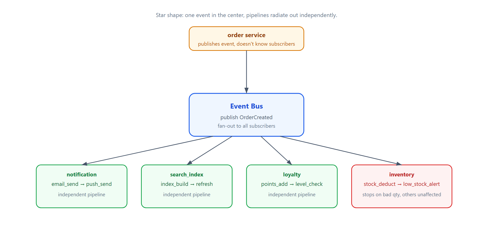
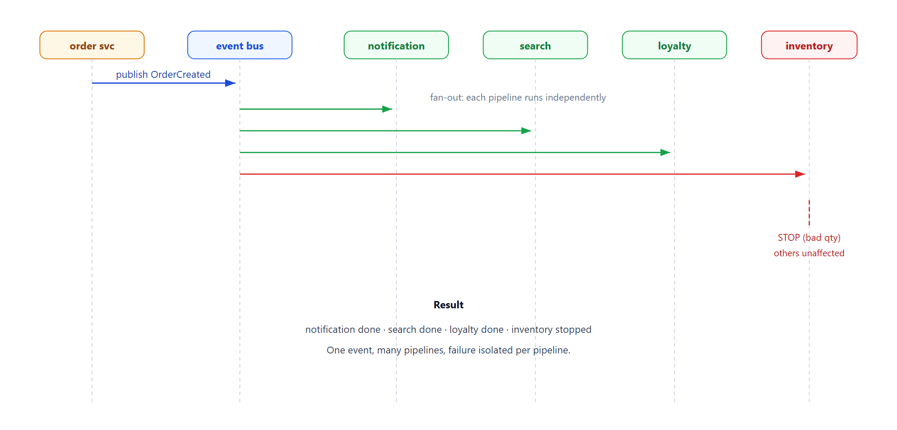

# Learn Event Fan-Out — Star Architecture with Independent Pipelines

> **Learning / study repo. Self-contained demo, NOT production code.**
> One event arrives at a central bus and fans out to many independent pipelines, each
> processing the event its own way. This is the star / pub-sub shape.

## The idea

```
                    ┌─► notification pipeline  (email + push)
                    │
 OrderCreated ──────┼─► search_index pipeline  (build + refresh)
   (event bus)      │
                    ├─► loyalty pipeline       (points + level)
                    │
                    └─► inventory pipeline      (deduct + alert)
```

- One event published once.
- Every subscribed pipeline runs independently.
- One pipeline failing or stopping does NOT break the others.
- Add a new subscriber (e.g. audit log) without touching existing pipelines.



## Why this shape

- **Decoupled producers and consumers** — order service doesn't know who cares.
- **Independent evolution** — change notification pipeline without touching inventory.
- **Failure isolation** — inventory stops on bad qty; email/search/loyalty still run.
- **Plug-grow** — add audit/BI/recommendation by subscribing a new pipeline.

## Run

```bash
python run_all.py
```

Pure Python standard library.

## Demo cases

1. **One event, 4 pipelines** — `OrderCreated` fans out to notification, search, loyalty, inventory.
2. **One pipeline stops, others continue** — inventory stops on zero qty; others still complete.
3. **Plug in a new subscriber** — audit log added; now 5 pipelines fan out, old ones untouched.

## Flow



## Sibling repos

- `learn_pipeline_filters` — the linear pipeline that each subscriber is built from.
- `learn_outbox_pattern` — how the event gets reliably to the bus.
- `learn_microservice_by_id` — services chained by ID.
- `learn_distributed_txn` — cross-service consistency.
